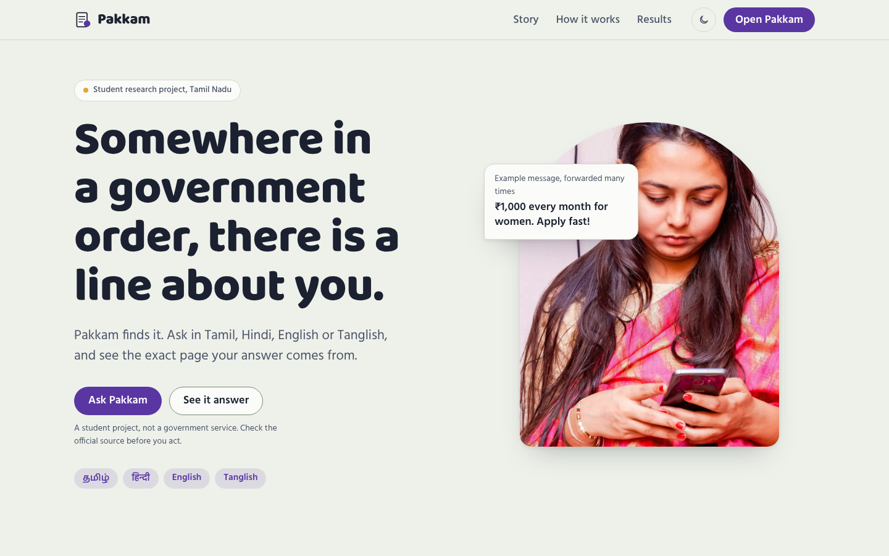
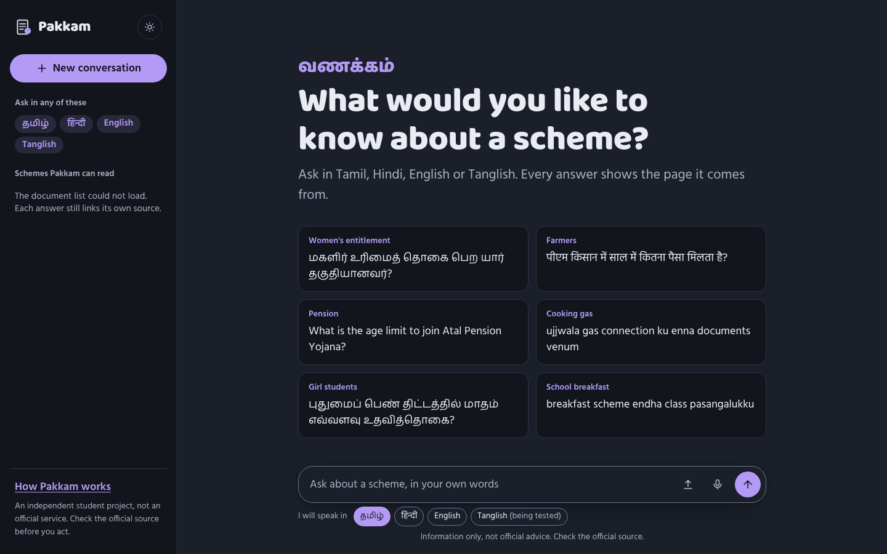
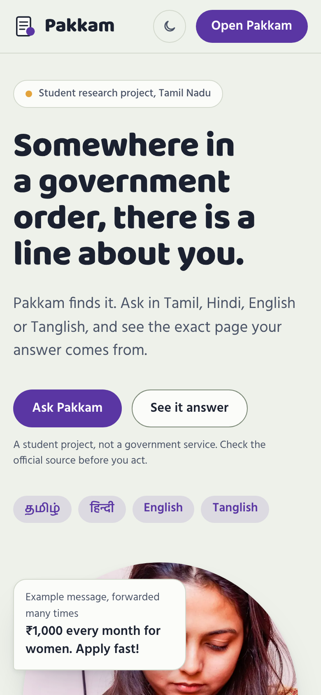

<div align="center">

# Pakkam · பக்கம்

**Ask about an Indian government scheme in your own language.<br>
See the exact page of the official document behind every sentence.**

Tamil · Hindi · English · Tanglish &nbsp;|&nbsp; text or voice &nbsp;|&nbsp; cited, or honestly "I don't know"

[](https://github.com/mailtojaswanthss-svg/pakkam/actions/workflows/ci.yml)


[**Live site**](https://pakkam-alpha.vercel.app) · [**Chat**](https://pakkam-alpha.vercel.app/chat/) · [How it works](#how-it-works) · [Results](#results) · [Quickstart](#quickstart) · [Status](STATUS.md)

</div>

<p align="center">
  
</p>

> **Disclaimer.** An independent student research prototype. It is **not** an official
> service and is **not affiliated with any government body**. Answers are informational
> only: check the official source before acting on them. It uses only public documents
> (listed in [docs/sources.csv](docs/sources.csv)) and stores no personal data
> ([docs/PRIVACY.md](docs/PRIVACY.md)).

---

## Why Pakkam

A forwarded message says *"₹1,000 every month for women. Apply fast!"* Is it real? Is it
meant for you? The answer is written down, in a 43-page government order in formal Tamil
and official English that few people have time to read. So people guess, pay a middleman,
or never apply.

Pakkam reads those pages for you. Ask the way you would ask at home, and it answers from
**18 official documents** only, shows **the page each sentence comes from**, and when the
documents don't say, **tells you so and gives the official helpline** instead of guessing.

*Pakkam* (பக்கம்) is Tamil for *page*: the page number is the product.

## Highlights

| | |
|---|---|
| **Every sentence is cited** | Each answer sentence links to the document and page it came from, with the passage and the official PDF one tap away. |
| **Four ways to ask** | Tamil, Hindi, English and Tanglish (Tamil in English letters), typed or spoken. Answers come back in the question's language. |
| **Numbers are checked, not trusted** | Every number in an answer (amounts, ages, dates, income limits, 2.5 lakh = 2,50,000) must appear in the cited text (`guardrails.py`); a second model checks the rest. Unsupported sentences are dropped. |
| **Honest refusals** | Low confidence means no LLM call: a calm card says the documents don't cover it and links the official contact. |
| **Sources in under half a second** | `/ask/sources` shows the cited pages in about 0.3-0.4 s while the answer is still being written. |
| **A conversation, not a form** | The page shows what it found while the answer is written, can be stopped, offers follow-ups ("How do I apply?") that remember the scheme, turns "did you mean A or B?" into buttons, shows the official pages when the model is busy, and asks for 👍/👎. |
| **Voice with Gnani** | Prisma speech to text ("Pakkam heard: ..."), a short spoken-style answer that is read out automatically, sentence by sentence, with "I heard X, is that right?" when unsure. |
| **Verified fact cards** | Ready answers for common questions with no LLM call and cached audio. A card is served only after a person signs it off (`verified_by`); the 2 drafted cards are not signed off yet. |
| **Private by design** | The audit log stores a hash of the question, never its text. No accounts, no personal data. |
| **Built for cheap phones** | Plain HTML/CSS/JS, no framework, light and dark themes, reduced-motion support, 44 px touch targets. |

## Screenshots

<table>
  <tr>
    <td width="70%"></td>
    <td width="30%"></td>
  </tr>
  <tr>
    <td align="center"><sub>Chat app (dark theme): suggestions in four scripts, mic and language picker</sub></td>
    <td align="center"><sub>Home page on a phone</sub></td>
  </tr>
</table>

## Tech stack

| Layer | What |
|---|---|
| Documents | 18 official PDFs (Tamil Nadu and central schemes), Tesseract OCR + Krutrim Chitrapathak-2 crop OCR for hard numerals |
| Search | BAAI `bge-m3` dense + learned sparse vectors in Qdrant, `bge-reranker-v2-m3` |
| Answers | Claude (`claude-opus-5-5` answers, `claude-haiku-5-5` checks) or Gemini, structured JSON with per-sentence citations, optional failover to the other provider, a daily call budget |
| Voice | Gnani Prisma v2.5 (speech to text), Gnani Timbre (text to speech), ffmpeg |
| API | FastAPI, rate limits, privacy-preserving audit log |
| Web | Plain HTML, CSS and JavaScript; Baloo 2 / Hind fonts; Vercel |
| Quality | pytest (532 tests), ruff, mypy, GitHub Actions |

---

## Contents

1. [How it works](#how-it-works)
2. [Results](#results)
3. [Quickstart](#quickstart)
4. [API](#api)
5. [Hosting](#hosting)
6. [Repository layout](#repository-layout)
7. [Documentation map](#documentation-map)
8. [Scripts](#scripts)
9. [Testing and CI](#testing-and-ci)
10. [Limitations](#limitations)
11. [Team and credits](#team-and-credits)
12. [Licences](#licences)

---

## How it works

```
Question (typed, or spoken -> Gnani Prisma v2.5 speech to text)
   │
   ├─ normalise (Unicode, numerals, Tanglish gloss for the reranker)
   │
   ├─ verified fact card matches? ── yes ──► card answer, 0 LLM calls, cached audio
   │
   ▼
Hybrid search in Qdrant: BGE-M3 dense + BGE-M3 learned sparse, fused
   │
Rerank with BGE-reranker-v2-m3
   │
   ├─ confidence < 0.35 ──► refuse, show the official contact (no LLM call)
   │
   ├─ POST /ask/sources returns the cited pages at once (no LLM call)
   │
LLM writes the answer in the question's language, one source list per sentence
(Claude by default, Gemini supported; a short spoken-style answer for voice)
   │
Guardrails: citation is valid · every number (amount, age, date, income limit)
must appear in the cited chunk (guardrails.py) · a second model checks support
   │
   ├─ unsupported sentences removed; nothing left ──► refuse
   │
Answer + citations (+ Gnani Timbre speech, sentence by sentence)
```

The pipeline stages live in `src/schemebot/`: `ingest/` → `index/` → `retrieve/` →
`generate/` → `api/`, plus `voice/` and `evaluation/`. Module notes are in
[docs/MODULE_NOTES.md](docs/MODULE_NOTES.md).

---

## Results

All figures come from committed scripts and are on **draft questions written by the
developer, not yet checked by a native speaker**. The refusal threshold was tuned on the
same questions, so treat them as development numbers. Each links to its full report.

| What | Result | n | Script | Report |
|---|---|---|---|---|
| Retrieval Recall@5 (hybrid + reranker) | 98.7% | 154 answerable of 194 | `ablate_retrieval.py` | [ablation](docs/review/RETRIEVAL_ABLATION_REPORT.md) |
| Correct refusals at threshold 0.35 | 92.5% (37/40) | 40 unanswerable | `evaluate_refusal_curve.py` | [curve](docs/review/REFUSAL_THRESHOLD_CURVE.md) |
| False refusals at 0.35 | 14.3% (22/154) | 154 answerable | same | same |
| Spoken question → right document | 90.3% (28/31) | 31 Kathbath read-speech clips | `speech_error_test.py` | [language table](docs/review/LANGUAGE_TABLE.md) |
| Spoken question → right page | 87.1% (27/31) | 31 | same | same |
| OCR numerals on known problem pages | Chitrapathak-2 7/7, Tesseract 0/7 | 7 pages chosen *because* Tesseract failed | `run_hybrid_ocr.py` | [OCR report](docs/review/ocr_benchmark_report.md) |
| Fact cards: false matches | 0 of 40 unanswerable questions | 40 | `fact_card_eval.py` | [fact cards](docs/review/FACT_CARD_EVAL.md) |

**Retrieval ablation** (`pakkam_chitra` collection, 194 draft questions):

| Mode | Recall@5 | Median retrieval time |
|---|---|---|
| Sparse only | 67.5% | 195.6 ms |
| Dense only | 94.8% | 52.1 ms |
| Dense + sparse | 94.8% | 215.6 ms |
| Dense + sparse + reranker | **98.7%** | 384.3 ms |

**Voice loop timing** (single runs on the developer's laptop, RTX 4060; see
[VOICE_LOOP_TIMING.md](docs/review/VOICE_LOOP_TIMING.md) and
[SENTENCE_SPEECH_REPORT.md](docs/review/SENTENCE_SPEECH_REPORT.md)):

| Stage | Time | Cumulative |
|---|---|---|
| Speech to text (Gnani Prisma) | 1.32 s | 1.32 s |
| Search | 0.22 s | 1.54 s |
| Rerank | 0.24 s | 1.77 s |
| Short voice answer (LLM) | 3.85 s | 5.62 s |
| First sentence spoken (Gnani Timbre) | 2.80 s | **8.42 s to first audio** |

The 5-second end-to-end voice target is **not met yet**. The cited pages appear in about
0.3-0.4 s through `POST /ask/sources`, before the answer is written.

OCR: 263 pages where Tesseract and Chitrapathak-2 read numbers differently are listed in
[ocr_disagreements.csv](docs/review/ocr_disagreements.csv) and are **not yet reviewed by a
person**.

---

## Quickstart

Needs [uv](https://docs.astral.sh/uv/), Python 3.11-3.12 and [ffmpeg](https://ffmpeg.org/) on
the PATH (voice uploads are converted with it). Tesseract (with `tam` and
`hin`) is needed only to rebuild the index. A GPU makes the models much faster.

```bash
cp .env.example .env        # add SCHEMEBOT_GEMINI_API_KEY (or Claude), optional Gnani key
uv sync --extra ingest --extra index --extra generate --extra gemini --extra api
uv run pytest -q            # fast tests, fake models, no API calls
```

The source PDFs and the search index are not in the repository. Download each document in
[data/sources.json](data/sources.json) into `data/raw/` under its `file` name, then:

```bash
uv run python -m schemebot.ingest     # PDFs -> chunks in data/processed/
uv run python -m schemebot.index      # chunks -> Qdrant index in data/index/
uv run fastapi run                    # site + API on http://localhost:8000
```

Open http://localhost:8000/chat/ (API docs at `/docs`). To use the Chitrapathak OCR
collection, set `SCHEMEBOT_QDRANT_COLLECTION=pakkam_chitra`. Every setting is listed in
[.env.example](.env.example).

**Speed and limits.** Answers use thinking effort `low` (several times faster than
`medium` for short cited answers), each LLM call waits at most 30 s and is retried once,
repeated questions come from an in-memory cache, and at most 200 LLM calls are made a day
(`SCHEMEBOT_MAX_DAILY_LLM_CALLS`; each answer uses two). A rate-limit reply (429) pauses that
model for 60 s, not for the day. With a paid Claude key (`SCHEMEBOT_LLM_PROVIDER=claude`),
Gemini can serve as the backup: `SCHEMEBOT_LLM_FALLBACK_ENABLED=true` plus a Gemini key. On
Gemini's free tier, set the daily cap near your free quota; Google may use free-tier prompts
to improve its products.

Windows step-by-step: [docs/HANDOFF.md](docs/HANDOFF.md) and
[docs/GNANI_RUNBOOK.md](docs/GNANI_RUNBOOK.md).

---

## API

Full schema: [docs/API_CONTRACT.md](docs/API_CONTRACT.md).

| Method | Path | What it does |
|---|---|---|
| POST | `/ask` | `{"question": "...", "voice_mode": false, "follow_up": {"question", "scheme"}}` → answer sentences, citations, status, timings; a follow-up like "how do I apply?" is read with the previous scheme |
| POST | `/ask/sources` | The cited pages only, no LLM call (shown while the answer is written) |
| POST | `/ask/voice` | Audio upload + language → transcript and answer |
| POST | `/transcribe` | Speech to text only ("Pakkam heard: ...") |
| POST | `/speak` | Text → 24 kHz WAV via Gnani Timbre |
| POST | `/feedback` | Thumbs up/down with an optional reason |
| GET | `/sources` | The 18 documents Pakkam reads |
| GET | `/health` | Model and budget status (no secrets) |

A refusal is a normal `200` response with its reason. `/ask` is rate limited per visitor
(10 a minute) and in total (500 a day); `/ask/sources`, `/speak` and `/feedback` have their
own, larger limits, and a spoken sentence is cached so replaying it costs no new Gnani call. Each request is logged to `logs/requests.jsonl`
**without the question text**: only a hash, length, language, citations and timings.

---

## Hosting

| Part | Where | Notes |
|---|---|---|
| Website (`web/`) | Vercel, free | Plain HTML/CSS/JS, no build step |
| Backend (FastAPI + models + index) | Developer's laptop, reached through a Cloudflare quick tunnel | `web/vercel.json` forwards `/ask`, `/ask/sources`, `/sources`, `/transcribe`, `/speak`, `/feedback`; the tunnel URL changes on every restart |
| Planned | Google Cloud Run (CPU) | [deploy/cloudrun/](deploy/cloudrun/README.md); the script asks for a GPU today |

Vercel cannot run the backend (PyTorch and about 4.5 GB of models exceed its function
limit), and Hugging Face Docker Spaces now need a paid plan. Docker: `docker compose up
--build` (see `compose.yaml`).

---

## Repository layout

```
src/schemebot/
  ingest/       PDF text, Tesseract OCR, Chitrapathak crop OCR, OCR corrections
  index/        BGE-M3 dense + sparse embeddings, Qdrant store
  retrieve/     hybrid search, reranker, Tanglish gloss
  generate/     answers, guardrails (number + support checks), fact cards, LLM providers,
                failover, daily budget, answer cache
  voice/        Gnani STT and TTS, amounts as words, daily call cap
  api/          FastAPI app, rate limits, audit log
  evaluation/   question set, metrics, judge, runner
data/           sources.json, contacts.json, corrections.json, fact_cards.json,
                eval/questions.jsonl (raw/, processed/, index/ are not committed)
web/            home page (index.html), chat app (chat/), assets/
scripts/        benchmarks, evaluations and report generators (see below)
tests/          unit and integration tests (fake models, no network)
docs/           reports and guides (see below); docs/archive/ holds superseded notes
deploy/         Cloud Run and Hugging Face Space recipes
```

---

## Documentation map

| Need | Read |
|---|---|
| Current status and blocked items | [STATUS.md](STATUS.md), [docs/review/BLOCKED.md](docs/review/BLOCKED.md) |
| Main benchmark and roadmap report | [docs/review/PAKKAM_2.0_MASTER_EXECUTION_REPORT.md](docs/review/PAKKAM_2.0_MASTER_EXECUTION_REPORT.md) |
| Technical report (original pipeline) | [docs/report.md](docs/report.md), [docs/results.md](docs/results.md), [docs/evaluation.md](docs/evaluation.md) |
| Project specification | [docs/PROJECT_SPECIFICATION.md](docs/PROJECT_SPECIFICATION.md) |
| Voice (Gnani) results | [docs/GNANI_RESULTS.md](docs/GNANI_RESULTS.md), [docs/GNANI_VOICE_REPORT.md](docs/GNANI_VOICE_REPORT.md) |
| Running a demo | [docs/DEMO_RUNBOOK.md](docs/DEMO_RUNBOOK.md), [docs/PHONE_TEST.md](docs/PHONE_TEST.md) |
| Teammate setup | [docs/HANDOFF.md](docs/HANDOFF.md) |
| Frontend design, story and motion | [docs/frontend-plan.md](docs/frontend-plan.md), [docs/design-package.md](docs/design-package.md), [docs/ux/](docs/ux/) |
| Data sources | [docs/data_sources.md](docs/data_sources.md), [docs/sources.csv](docs/sources.csv) |
| Submission | [docs/SUBMISSION_CHECKLIST.md](docs/SUBMISSION_CHECKLIST.md), [docs/CONTRIBUTIONS.md](docs/CONTRIBUTIONS.md) |
| Per-topic benchmark reports | [docs/review/](docs/review/) |
| Superseded reports and old plans | [docs/archive/](docs/archive/) |

---

## Scripts

Run with `uv run python scripts/<name>.py`. Scripts that call paid or capped APIs ask
before they spend.

| Area | Scripts |
|---|---|
| Retrieval and refusal | `ablate_retrieval.py`, `evaluate_refusal_curve.py`, `benchmark_instant_sources.py`, `paraphrase_eval.py` |
| Answers and grading | `answer_eval.py`, `answer_eval_summary.py`, `make_grading_sheet.py`, `generate_sample_answers.py`, `fact_card_eval.py`, `compare_llm_providers.py`, `benchmark_speed.py`, `run_daily.py` |
| Voice (Gnani) | `gnani_doctor.py`, `gnani_smoke.py`, `gnani_stt_eval.py`, `capture_prisma_raw.py`, `speech_error_test.py`, `eval_tanglish_clips.py`, `eval_field_clips.py`, `fetch_kathbath_sample.py`, `voice_loop_timing.py`, `test_sentence_speech.py`, `make_card_audio.py` |
| OCR | `run_hybrid_ocr.py`, `run_crop_ocr.py`, `colab_chitrapathak.py`, `ocr_compare.py`, `flag_ocr_pages.py`, `generate_gate_pages.py`, `analyze_disagreements.py`, `report_ocr_stats.py`, `check_corrections.py` |
| Reports | `generate_gnani_report.py`, `generate_voice_report.py`, `generate_docx_report.py`, `summarize_questions.py` |
| Running | `start_pakkam.ps1` (one click: latest code, backend, tunnel, website pointed at it) |
| Checks | `scan_git_secrets.py`, `check_helplines.py`, `verify_dod.py`, `review_feedback.py` |

The package also has its own commands: `python -m schemebot.evaluation`,
`python -m schemebot.voice` (compare, tts-samples, eval-script, eval, amounts) and
`python -m schemebot.retrieve` / `schemebot.generate` for one question.

---

## Testing and CI

```bash
uv run ruff check . && uv run ruff format --check .
uv run mypy src
uv run pytest -q              # 532 tests, fake models
uv run pytest -m models       # slower tests with the real models (~4.5 GB download)
```

`.github/workflows/ci.yml` runs lint, format, mypy and the fast tests on every push and
pull request, without PyTorch, and builds the Docker image on pushes.

---

## Limitations

- Questions are **drafts** by one person; native-speaker review and an independent held-out
  set are pending.
- Answer quality has not been graded by people yet (`docs/review/grading_sheet.csv`).
- Voice is tested on clean read speech only; real phone recordings and spoken Tanglish are
  untested.
- Tanglish has the highest false-refusal rate of the four language groups.
- Hindi coverage is thin (2 Hindi documents).
- 263 OCR number disagreements and the OCR corrections in `data/corrections.json` still
  need a person to confirm them.
- Helpline numbers in `data/contacts.json` must be checked against official pages
  (`docs/review/helpline_check.csv`).
- On Gemini's free tier, answers can take 10 s to over a minute and the daily quota runs out
  quickly; a paid key (Claude or Gemini) is needed for a public demo.

---

## Team and credits

| Person | Role |
|---|---|
| Jaswanth ([@mailtojaswanthss-svg](https://github.com/mailtojaswanthss-svg)) | Project lead: product, design direction, engineering, evaluation |
| _Teammate name_ | _Role_ |

Day-by-day contributions are logged in [docs/CONTRIBUTIONS.md](docs/CONTRIBUTIONS.md).
Built with help from Claude (Anthropic) as a coding assistant.

---

## Licences

- **Code:** [MIT](LICENSE).
- **Government documents:** remain the property of their publishing departments and are not
  redistributed here; see [docs/sources.csv](docs/sources.csv).
- **Chitrapathak-2** (`krutrim-ai-labs/Chitrapathak-2`) by Krutrim AI Labs, under the
  Krutrim Community License Agreement 1.0, used for non-commercial research; OCR outputs
  are attributed to Krutrim. Details: [docs/LICENSE_NOTES.md](docs/LICENSE_NOTES.md).
- **Models:** `BAAI/bge-m3` (MIT) and `BAAI/bge-reranker-v2-m3` (Apache 2.0).
- **Speech data:** evaluation clips from AI4Bharat Kathbath (CC BY 4.0).
- **Photos:** Unsplash License ([CREDITS.md](CREDITS.md)).
