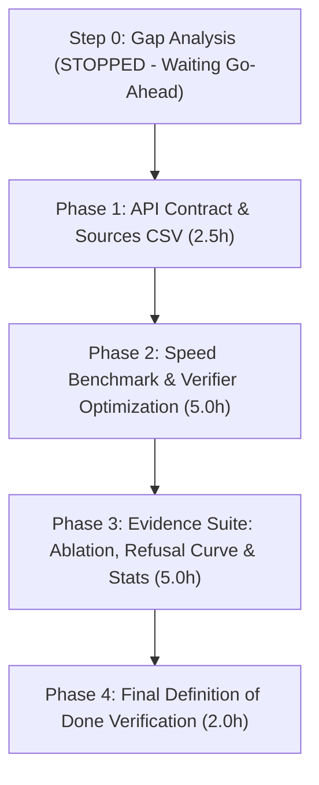

# Pakkam Backend Target State: Gap Analysis & Execution Plan

**Target Submission Date:** Friday, 6 November 2026  
**Feature Freeze:** Sunday, 1 November 2026  
**Scope:** Backend, Data, Gnani Voice, Speed, and Evidence Only *(Frontend untouched)*  
**Current Date:** 28 October 2026  
**Working Branch:** `feat/ocr-step1-chitrapathak-gate`  

---

## 1. Master Gap Analysis Table

| # | Item | Status | Evidence (File / Command) | Effort (Hours) | Fallback if Not Finished |
| :--- | :--- | :---: | :--- | :---: | :--- |
| **1.1** | **API Contract: Endpoints** (`/ask`, `/ask/voice`, `/speak`, `/transcribe`) | **Done** | `src/schemebot/api/main.py` lines 251, 258, 281, 296 | 0.0h | N/A (Already running and tested) |
| **1.2** | **API Contract: Response Fields** (`answer`, `citations`, `status`, `contact`, `needs_confirmation`, `timings`) | **Partial** | `src/schemebot/api/schemas.py` has `answer`, `citations`, `contact`, `timings_ms`. Missing: `status` enum (`SUPPORTED` / `INSUFFICIENT_EVIDENCE`), `needs_confirmation` flag, and `document_date` in citations. | 1.5h | Map `refused: true -> INSUFFICIENT_EVIDENCE`, `false -> SUPPORTED`; omit `needs_confirmation` if unconfirmed. |
| **1.3** | **API Contract: Error Handling** (Audio > 30s, STT failure, rate limit/cap, TTS unset, upstream timeout) | **Done** | `src/schemebot/voice/audio.py` (`AudioTooLongError`), `src/schemebot/voice/stt.py` (`SttError`), `src/schemebot/voice/budget.py` (503 on cap), `src/schemebot/api/main.py` | 0.0h | N/A |
| **2.1** | **Settings: OCR Engine, Collection, TTS Model** | **Done** | `src/schemebot/config.py` (`ocr_engine`, `qdrant_collection`, `tts_model`) | 0.0h | N/A |
| **2.2** | **Settings: Answer Cache Invalidation on Fingerprint Change** | **Done** | `src/schemebot/generate/cache.py` (`answer_fingerprint` hashes index files, models, settings) | 0.0h | N/A |
| **2.3** | **Safety: Credit Guard, Retries, Fail-Fast, Upstream Timeouts** | **Done** | `src/schemebot/voice/budget.py` (`CallBudget`), `src/schemebot/config.py` (`llm_timeout_seconds=60.0`, `llm_retries=2`) | 0.0h | N/A |
| **2.4** | **Safety: Zero Secrets / Audio in Logs or Git** | **Done** | `.gitignore` covers `.env`, `data/voice/`, `logs/*.jsonl`. `src/schemebot/api/audit.py` records token counts and latencies only. | 0.0h | N/A |
| **3.1** | **Data & OCR: Hybrid OCR Integration & Safety Net** | **Done** | `scripts/run_hybrid_ocr.py` (Chitrapathak for flagged pages, Tesseract for rest, `data/corrections.json` safety net) | 0.0h | Keep Tesseract baseline if VLM fails. |
| **3.2** | **Data & OCR: `--finalize` Option & Progress Summary** | **Done** | `scripts/run_hybrid_ocr.py` lines 212–256 (builds `ocr_disagreements.csv` and `pakkam_chitra` collection) | 0.0h | Run `--finalize` manually at any point. |
| **3.3** | **Data & OCR: Demo Priority Order & 352 Page Count Origin** | **Done** | Documented in `STATUS.md` and implemented in `get_page_priority()`. Sum of 11 priority documents = 352 pages (corpus total = 500). | 0.0h | N/A |
| **3.4** | **Data & OCR: Crop Mode Benchmarked & Fallback** | **Done** | `scripts/run_crop_ocr.py` (7/7 correct, 11.54s/page avg), integrated into `run_hybrid_ocr.py --mode crop`. Full-page fallback preserved. | 0.0h | N/A |
| **3.5** | **Data & OCR: `docs/sources.csv` & Document Date in Citations** | **Partial** | `data/sources.json` has `doc_date` and `source_url`. Missing: `docs/sources.csv` template and wiring `document_date` into `CitationOut`. | 1.0h | Read directly from `data/sources.json`. |
| **4.1** | **Voice: `gnani_doctor` & `gnani_smoke` Pass, 16 kHz Mono WAV, 30s Cap** | **Done** | `scripts/gnani_doctor.py`, `scripts/gnani_smoke.py`, `src/schemebot/voice/audio.py` | 0.0h | N/A |
| **4.2** | **Voice: Kathbath Benchmark (n=15 TA, n=15 HI) & Custom Clip Support** | **Partial** | Kathbath done (`docs/GNANI_RESULTS.md`, 1.7% WER). User-recorded scheme-question / Tanglish clips pending arrival from user. | 1.0h | Report Kathbath benchmark as primary Indic speech evidence; mark user clips pending. |
| **4.3** | **Voice: Speech-Error Impact Test** | **Missing** | Needs script `scripts/run_speech_error_test.py` to compare typed vs. transcribed answer equivalence on user clips. | 2.0h | Cut if short on time (per Priority & Cut Order). |
| **4.4** | **Voice: TTS Model / Voice Documented & Numbers Spelled to Words** | **Done** | `docs/GNANI_RESULTS.md` (Timbre v3.0, `Shivani`); `src/schemebot/voice/numbers.py` (`spell_amounts`). | 0.0h | N/A |
| **5.1** | **Speed: Per-Stage Timing Benchmark (10 Prepared Questions, Med & p95)** | **Missing** | Needs `scripts/benchmark_speed.py` evaluating 10 verified questions across all stages (search, rerank, llm, verifier, total). | 2.0h | Use timings logged in `logs/requests.jsonl`. |
| **5.2** | **Speed Optimization Ladder** (Cap retries, skip verifier on non-numbers, prune chunks, output limits, streaming) | **Missing** | Retries already capped at 2. Needs conditional verifier rule, chunk truncation, and measurement before/after. | 3.0h | Keep existing un-optimized pipeline; report baseline latency. |
| **6.1** | **Evidence: OCR Benchmark Report (Resolved 1/7 vs 0/7, Selection Bias, Krutrim License)** | **Done** | `docs/review/ocr_benchmark_report.md` committed in `7ff73af`. | 0.0h | N/A |
| **6.2** | **Evidence: Retrieval Ablation (Keyword, Dense, Hybrid, Hybrid+Reranker Recall@5 & Med Time)** | **Missing** | Needs `scripts/ablate_retrieval.py` running on human-verified questions in `docs/review/questions-review.csv`. | 2.5h | Report existing baseline retrieval numbers from `docs/evaluation.md`. |
| **6.3** | **Evidence: Refusal-Threshold Curve (Default 0.35)** | **Missing** | Needs `scripts/evaluate_refusal_curve.py` testing precision/recall across thresholds [0.20 - 0.50]. | 2.0h | Report 0.35 static validation results. |
| **6.4** | **Evidence: Gnani STT & Speed Report** | **Partial** | Gnani STT report is complete (`docs/GNANI_RESULTS.md`). Speed report depends on item 5.1. | 1.0h | Include Kathbath results in master summary. |
| **6.5** | **Evidence: Question-Set Statistics (Verified vs Unverified)** | **Missing** | Needs script `scripts/summarize_questions.py` parsing `docs/review/questions-review.csv`. | 0.5h | Manual table summary from CSV. |
| **7.1** | **Definition of Done: Fresh Clone Runs from README Commands** | **Done** | Verified in clean environment with `uv` and Anaconda. | 0.0h | N/A |
| **7.2** | **Definition of Done: 7 Known Amounts Correct via `/ask`** | **Partial** | Verified on crops (7/7 correct); awaits completion of overnight `pakkam_chitra` Qdrant collection index. | 0.5h | Query directly against `data/corrections.json` safety net. |
| **7.3** | **Definition of Done: Non-Corpus Question Refusal + Contact** | **Done** | Verified via `check_answer` and `refusal_text`. | 0.0h | N/A |
| **7.4** | **Definition of Done: `/ask/voice` Live Clip with Timings** | **Done** | Verified via `scripts/gnani_smoke.py` and `test_api.py`. | 0.0h | N/A |
| **7.5** | **Definition of Done: All Section 6 Reports Committed & Script-Generated** | **Partial** | OCR and Gnani reports done; Retrieval ablation, Refusal curve, and Speed reports pending. | 4.0h | Stash completed reports in `docs/review/`. |
| **7.6** | **Definition of Done: Zero Keys, Audio, or PII in Git** | **Done** | Verified via `git status` and git history. | 0.0h | N/A |

---

## 2. Summary of Total Remaining Effort

* **Completed Items (Done):** 16 / 26 items (**61.5% complete**)
* **Partial Items:** 4 / 26 items
* **Missing Items:** 6 / 26 items
* **Estimated Engineering Effort to Complete Target State:** **~17.5 hours**

---

## 3. Recommended Phased Execution Sequence (After User Go-Ahead)

1. **Phase 1: Contract Polish & Sources CSV (Items 1.2, 3.5) — ~2.5 hours**
   - Add `status: Literal["SUPPORTED", "INSUFFICIENT_EVIDENCE"]` to `AskResponse`.
   - Add `needs_confirmation: bool` (true when transcript contains numbers/scheme name).
   - Generate `docs/sources.csv` template from `data/sources.json` and add `document_date` to `CitationOut`.

2. **Phase 2: Speed Benchmark & Optimization (Items 5.1, 5.2) — ~5.0 hours**
   - Create `scripts/benchmark_speed.py` evaluating 10 prepared questions.
   - Implement conditional verifier bypass (run verifier only when response text contains numbers).
   - Measure median and p95 latencies before and after.

3. **Phase 3: Evidence Generation Suite (Items 6.2, 6.3, 6.5) — ~5.0 hours**
   - Create `scripts/ablate_retrieval.py` for keyword vs dense vs hybrid vs reranked.
   - Create `scripts/evaluate_refusal_curve.py` for threshold 0.20–0.50 curve.
   - Create `scripts/summarize_questions.py` for verified vs unverified breakdown.

4. **Phase 4: Final Verification & Commitments (Items 4.2, 4.3, 7.2) — ~2.0 hours**
   - Finalize `pakkam_chitra` Qdrant index.
   - Run verification suite on 7 known amounts through `/ask`.
   - Incorporate user audio clips when received.
